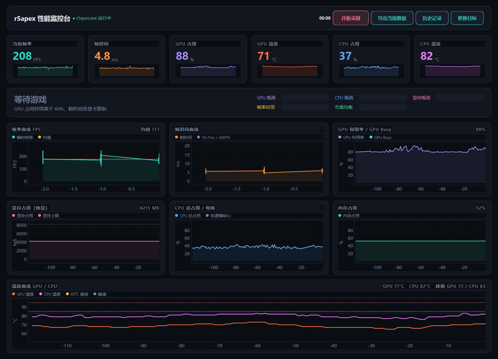
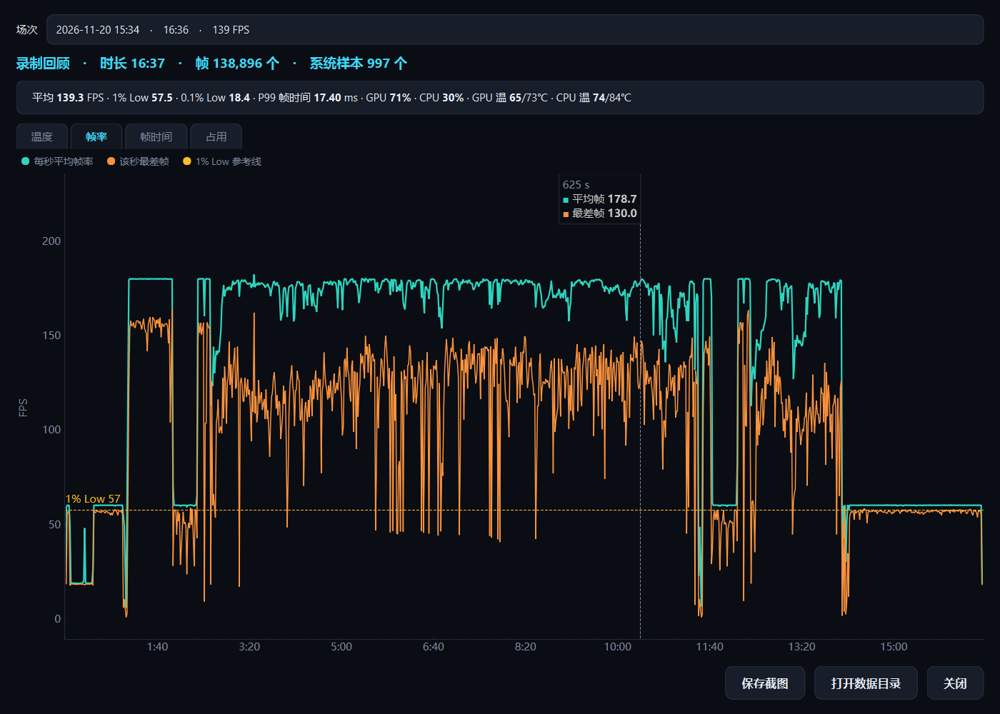
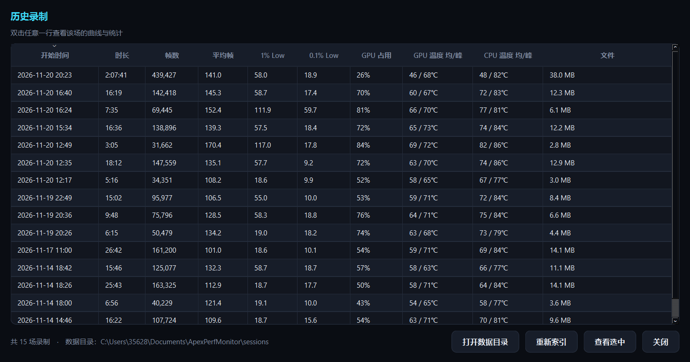

# FrameLens · 帧镜

**Windows 上通用的实时性能监控与录制工具**——不绑定某一个游戏，你可以选择任意程序，查看它的帧率、帧时间、GPU/CPU 占用和温度，并把整场数据保存下来反复回看。



## 为什么做它

市面上的帧率工具大多只服务于某一款游戏，或者要付费、界面停留在十年前。FrameLens 想做的是**一个通用的、开箱即用的本地性能观测台**：

- 换游戏、换程序不用换工具，选一次进程就行
- 数据全部落在本地，不上传、不联网
- 只读采集，不注入、不 Hook、不碰游戏内存

## 功能

**实时监控**

- 帧率 / 帧时间（来自 Windows ETW 的真实 Present 事件，不是估算）
- GPU 利用率、GPU Busy、显存占用、GPU 温度与热点温度
- CPU 总占用、每核占用、CPU 温度
- 内存占用、目标进程 CPU 占用
- 实时曲线（帧率、帧时间、GPU/CPU、显存、温度），鼠标悬停可读出任意时刻的数值

**瓶颈判定**

软件会根据 GPU 占用、GPU/CPU Busy、帧率波动等指标给出当前瓶颈倾向（GPU 瓶颈 / CPU 瓶颈 / 显存瓶颈 / 帧率封顶 / 负载均衡），并说明判断依据。

**录制与回看**

- 一键录制，全程流式写 CSV，长录制不会截断
- 录制结束自动打开回顾窗口：温度、帧率、帧时间、占用四个页签，全部支持悬停读数
- 「历史记录」列出所有录制场次，含平均帧、1% Low、0.1% Low、温度峰值，点表头可排序，双击直接进回顾
- 回顾窗口可一键保存当前界面截图

**面向真实使用场景的细节**

- 「游戏不在前台」造成的连续低帧会被自动剔除，不污染平均帧与 1% Low
- 反作弊拦截采集时会在界面上明确提示，并说明处理办法，不静默失败
- 软件被强杀后残留的采集子进程会在下次启动时自动清理
- 目标进程退出再启动，采集会话自动重建





## 系统要求

- Windows 10 / 11（x64）
- **管理员权限**（读取 ETW 帧事件需要）
- Python 3.10+（仅源码运行需要）
- AMD 显卡可读取温度；NVIDIA 显卡的占用与帧率正常，部分温度项可能显示为空

## 快速开始

### 方式一：下载 Release（推荐）

到 [Releases](../../releases) 下载源码包，解压后按下面的源码方式运行；想要免安装的 EXE，用第四种方式自行打包即可。
首次启动会弹出提权确认，并让你选择一个要监控的程序。

### 方式二：源码运行

```bash
git clone https://github.com/uoolp/FrameLens.git
cd FrameLens
pip install -r requirements.txt
python app/main.py
```

### 方式三：自己打包

```bash
pip install pyinstaller
pyinstaller FrameLens.spec --noconfirm
```

产物在 `dist/FrameLens/`，整个文件夹一起拷走即可。

## 使用

**1. 选目标**

启动后弹出进程列表，按名字搜索，或者直接手输 `xxx.exe`。列表会把当前前台窗口所在的程序标出来，通常就是你要监控的那个。
配置会记住上次选择，下次启动直接用。

**2. 录制**

点「开始录制」开始采集，再点一次结束并生成报告。想换程序随时点「更换目标」，不用重启软件。

**3. 回顾**

录制结束会自动弹出回顾窗口。也可以用「历史记录」挑任意一场打开。
四个页签里鼠标在曲线上移动，就能读到那一刻的具体数值。

**4. 数据在哪**

`文档\FrameLens\sessions\`，每场两个 CSV（帧数据 + 系统采样），纯文本，可以直接用 Excel 或 Python 分析。

## 采集原理与反作弊

FrameLens 用 Intel 开源的 [PresentMon](https://github.com/GameTechDev/PresentMon) 读取 Windows 标准的 ETW（Event Tracing for Windows）Present 事件。

这是**只读**的系统级事件订阅：不注入进程、不 Hook API、不读写游戏内存、不修改游戏文件。CapFrameX、NVIDIA FrameView 等工具用的是同一套机制。

需要知道的限制：部分带反作弊的游戏（例如 Easy Anti-Cheat）在游戏已经运行时，会拒绝创建新的 ETW 会话。表现是「目标在跑但采不到帧」。解决办法很简单——**先开 FrameLens，再启动游戏**。软件检测到这种情况会在状态栏提示。

## 项目结构

```
FrameLens/
├── app/
│   ├── main.py            入口：提权、路径解析、组件装配
│   ├── controller.py      采集控制器：PresentMon + 系统采样器的生命周期与热切换
│   ├── config.py          用户配置持久化
│   ├── target_picker.py   目标进程选择界面
│   ├── presentmon.py      ETW 帧采集与 PID 兜底匹配
│   ├── system_metrics.py  GPU / CPU / 内存 / 温度 1 Hz 采样
│   ├── gpu_enum.py        显卡枚举与显存识别
│   ├── gpu_pdh.py         PDH 性能计数器读取
│   ├── cpu_temp.py        CPU 温度读取
│   ├── temp_sensor.py     温度传感器抽象层
│   ├── winproc.py         Toolhelp32 进程与窗口枚举
│   ├── attach_desktop.py  把 GUI 线程绑定到用户输入桌面（沙箱/服务环境下窗口可见）
│   ├── data_store.py      环形缓冲、录制、CSV 导出
│   ├── bottleneck.py      瓶颈判定规则
│   ├── main_window.py     主界面：KPI、曲线、录制控制
│   ├── chart_hover.py     曲线悬停读数组件
│   ├── review_window.py   录制回顾：四个页签 + 场次切换
│   ├── history_window.py  历史场次列表
│   ├── session_index.py   会话索引与摘要缓存
│   └── theme.py           深色主题与 QSS
├── bin/
│   └── PresentMon.exe     Intel PresentMon 2.6（MIT）
├── docs/                  截图
├── FrameLens.spec         PyInstaller 打包配置
└── requirements.txt
```

## 常见问题

**Q：状态栏显示「采集被反作弊拦截」怎么办？**
退出游戏，等几秒状态恢复正常，再重新启动游戏。或者干脆设成开机自启，永远先开监控。

**Q：平均帧和该秒最差帧有什么区别？**
平均帧是那一秒内所有帧的平均值；最差帧是那一秒里最长的一帧帧时间反算出的 FPS。前者看整体流畅度，后者看卡顿感。

**Q：1% Low 是怎么算的？**
把整场所有帧的帧时间排序，取第 99 百分位那一帧，用 1000 / 它换算成 FPS。它反映"最差的那 1% 帧有多差"。

**Q：为什么有时帧率会稳定掉到 60？**
多半是切到后台或失焦了，部分游戏会自动把后台帧率压到 60。也可能是开了垂直同步或驱动的帧率限制。

**Q：数据会上传吗？**
不会。所有数据只存在本机 `文档\FrameLens\sessions\`。

## 已知限制

- 目前只在 Windows 上运行，依赖 ETW 与 PDH
- NVIDIA 显卡的温度读取部分场景为空（走的是 AMD ADL，其他厂商待适配）
- 温度传感器在不同笔记本上差异较大，读数可能不准
- 逐秒统计在遇到极端长帧时会出现尖峰，这是真实数据而不是绘图错误

## 致谢

- [PresentMon](https://github.com/GameTechDev/PresentMon) — Intel 开源的帧采集工具，MIT License
- [pyqtgraph](https://www.pyqtgraph.org/) — 高性能实时绘图
- [PySide6](https://doc.qt.io/qtforpython/) / [Qt](https://www.qt.io/) — 界面框架

## License

MIT，见 [LICENSE](LICENSE)。
